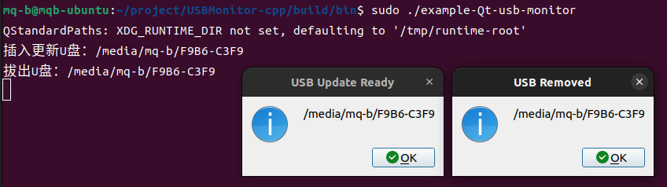
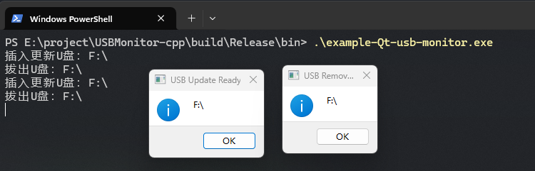

# USBMonitor-cpp

[](https://github.com/Mq-b/USBMonitor-cpp/actions/workflows/ci.yml)
[](https://en.cppreference.com/w/cpp/20)
[](https://github.com/Mq-b/USBMonitor-cpp)
[](LICENSE)

一个使用现代C++20编写的跨平台USB设备监控库。采用PImpl模式、Concepts、std::jthread等现代C++特性，提供了类型安全、易于使用的API。

## ✨ 主要特性

- **🚀 现代C++20**: 使用 std::jthread、Concepts、std::format 等最新特性
- **🎯 PImpl设计**: 完全隐藏平台实现，公共接口无宏污染
- **📦 纯头文件库**: 无需编译链接，只需包含头文件
- **🔧 可配置日志**: 支持自定义日志回调或完全禁用（零开销）
- **🌍 跨平台支持**: Windows 和 Unix/Linux
- **🧵 线程安全**: 使用互斥锁保护共享数据
- **♻️ RAII设计**: 自动资源管理，无需手动清理

## 📋 要求

- **C++标准**: C++20 或更高
- **编译器**:
  - GCC 11+
  - Clang 13+
  - MSVC 19.29+ (Visual Studio 2022)
- **CMake**: 3.10 或更高（仅用于编译示例）

> [!NOTE]
> `USBMonitor-cpp` 是一个**纯头文件库**，你只需要将 include 文件夹的内容复制到自己项目目录即可使用。

## 📖 快速开始

### 基础用法（新API）

```cpp
#include <usb_monitor.h>
#include <iostream>

using namespace usb_monitor;

int main() {
    // 创建USB监控器，传入事件回调
    USBMonitor monitor([](UsbState state, std::string_view path) {
        switch (state) {
            case UsbState::Removed:
                std::cout << "USB已拔出: " << path << '\n';
                break;
            case UsbState::Inserted:
                std::cout << "USB已插入: " << path << '\n';
                break;
            case UsbState::UpdateReady:
                std::cout << "更新U盘已插入: " << path << '\n';
                break;
        }
    });

    // 启动监控
    monitor.start();

    std::cout << "USB监控已启动，按Enter退出...\n";
    std::cin.get();

    // 析构时自动停止监控
    return 0;
}
```

### 自定义日志

```cpp
#include <usb_monitor.h>

using namespace usb_monitor;

int main() {
    // 创建自定义日志器
    auto logger = std::make_unique<CallbackLogger>(
        [](LogLevel level, std::string_view msg) {
            std::cerr << "[" << log_level_to_string(level) << "] "
                     << msg << '\n';
        }
    );

    // 使用自定义日志器创建监控器
    USBMonitor monitor(
        [](UsbState state, std::string_view path) {
            // 处理USB事件
        },
        std::move(logger)
    );

    monitor.start();
    std::cin.get();

    return 0;
}
```

### 零日志开销模式

```cpp
#include <usb_monitor.h>

using namespace usb_monitor;

int main() {
    // 使用NullLogger完全禁用日志（零开销）
    USBMonitor monitor(
        [](UsbState state, std::string_view path) {
            // 只处理USB事件，不输出日志
        },
        std::make_unique<NullLogger>()
    );

    monitor.start();
    std::cin.get();

    return 0;
}
```

### Qt集成示例

```cpp
#include <usb_monitor.h>
#include <QObject>

using namespace usb_monitor;

class UsbWatcher : public QObject {
    Q_OBJECT
public:
    UsbWatcher() {
        monitor_ = std::make_unique<USBMonitor>(
            [this](UsbState state, std::string_view path) {
                // 通过Qt信号安全地跨线程传递事件
                emit usbEvent(
                    static_cast<int>(state),
                    QString::fromStdString(std::string(path))
                );
            }
        );
        monitor_->start();
    }

signals:
    void usbEvent(int state, const QString& path);

private:
    std::unique_ptr<USBMonitor> monitor_;
};
```

## 构建

```shell
git clone https://github.com/Mq-b/USBMonitor-cpp
cd USBMonitor-cpp
mkdir build && cd build
cmake .. -DCMAKE_BUILD_TYPE=Release
cmake --build . --config Release
```

编译后的示例程序位于 `build/Release/bin/Release/` 目录。

### 测试环境

✅ **Linux**: Ubuntu 22.04 (GCC 11/12/13, Clang 13+)
✅ **Windows**: Windows 10/11 (Visual Studio 2022, MSVC 19.29+)

持续集成测试每次提交都会在 Linux 和 Windows 平台上自动运行。

## 🎨 设计亮点

### PImpl模式 - 零宏公共接口

**传统做法（已废弃）：**
```cpp
// 旧版：公共接口充满宏
#ifdef _WIN32
#include "win/winUSBMonitor.h"
#elif defined(__linux__)
#include "unix/unixUSBMonitor.h"
#endif
```

**现代做法：**
```cpp
// 新版：公共接口完全无宏！
#include <usb_monitor.h>

// 平台选择在实现层完成，用户代码无宏污染
usb_monitor::USBMonitor monitor([](auto state, auto path) {
    // 跨平台代码，无需任何宏
});
```

### C++20特性应用

| 特性 | 用途 | 优势 |
|------|------|------|
| **std::jthread** | 线程管理 | 自动join，支持协作式取消 |
| **Concepts** | 类型约束 | 编译期检查，清晰错误信息 |
| **std::format** | 字符串格式化 | 类型安全，性能优于iostream |
| **std::source_location** | 日志定位 | 自动捕获源码位置 |
| **enum class** | 枚举类型 | 强类型，避免命名冲突 |

## 📚 API参考

### USBMonitor类

```cpp
namespace usb_monitor {

class USBMonitor {
public:
    // 构造函数（使用Concepts约束）
    template<UsbEventCallback F>
    explicit USBMonitor(
        F&& callback,
        std::unique_ptr<ILogger> logger = std::make_unique<DefaultLogger>()
    );

    void start();                              // 启动监控
    void stop();                               // 停止监控
    bool is_running() const noexcept;          // 查询状态
    void set_poll_interval(std::chrono::milliseconds); // 设置轮询间隔
};

} // namespace usb_monitor
```

### UsbState枚举

```cpp
enum class UsbState : std::uint8_t {
    Removed,      // U盘拔出
    Inserted,     // U盘插入
    UpdateReady   // 更新U盘（包含/update目录且非空）
};
```

### 日志系统

```cpp
enum class LogLevel : std::uint8_t {
    Trace, Debug, Info, Warning, Error
};

class ILogger { /* 日志接口 */ };
class DefaultLogger : public ILogger;  // 默认：输出到std::clog
class CallbackLogger : public ILogger; // 自定义回调
class NullLogger : public ILogger;     // 零开销：不输出
```

## 🔄 从旧版本迁移

如果你有使用旧版本（C++17宏驱动）的代码：

| 项目 | 旧版本 | 新版本 |
|------|--------|--------|
| **头文件** | `#include <USBMonitor.h>` | `#include <usb_monitor.h>` |
| **命名空间** | 无 | `using namespace usb_monitor;` |
| **枚举访问** | `UsbState::Removed` | `UsbState::Removed`（相同） |
| **API调用** | `monitor.startMonitoring()` | `monitor.start()` |
| **回调参数** | `std::string path` | `std::string_view path` |

> 💡 提供了兼容层 `usb_monitor_compat.h`，旧代码可继续工作（会有deprecation警告）。

## 📁 项目结构

```
include/
├── usb_monitor.h                    # 主API（用户唯一需要包含的文件）
├── usb_monitor_types.h              # 类型定义（enum class, concepts）
├── usb_monitor_logger.h             # 日志系统
├── usb_monitor_compat.h             # 向后兼容层（可选）
└── detail/                          # 实现细节（用户不直接包含）
    ├── usb_monitor_impl.h           # 平台无关基类
    ├── usb_monitor_inline.h         # PImpl桥接实现
    └── platform/
        ├── win_usb_monitor_impl.h   # Windows实现
        └── unix_usb_monitor_impl.h  # Unix实现
```

## 🧪 测试说明

在 Ubuntu22.04 中使用 GCC11、GCC12、GCC13 测试无误。



在 Windows 使用 Visual Studio 2022 测试无误。



---

### Linux测试（WSL等无桌面系统）

如果需要在 WSL 之类的无桌面 Linux 系统中测试，需要显式挂载外部存储设备：

```shell
# 挂载外部存储（E是Windows中的盘符）
mount -t drvfs E: /media/A/E

# 手动拔出设备后解除挂载点
sudo umount /media/A/E
# 删除文件夹
sudo rm -rf /media/A/E
```

测试输出示例：

```txt
root@Mq-B:~/test/USBMonitor-cpp/build/bin# sudo ./example-basic-example
[INFO] USB monitor started (Unix/Linux)
✓ USB已插入: /media/A/E
[INFO] USB inserted: /media/A/E
✗ USB已拔出: /media/A/E
[INFO] USB removed: /media/A/E
```

如果是完整的带桌面的系统会自动处理挂载和卸载。

## 🤝 贡献

欢迎提交 Issue 和 Pull Request！

在提交 PR 前请确保：
- 代码符合 C++20 标准
- 通过所有 CI 测试（Linux 和 Windows）
- 遵循项目的代码风格

## 📄 许可证

本项目采用 MIT 许可证 - 详见 [LICENSE](LICENSE) 文件

## 🙏 致谢

- 感谢现代C++社区的最佳实践指导
- 感谢所有贡献者的支持

## 📮 联系方式

- GitHub Issues: [https://github.com/Mq-b/USBMonitor-cpp/issues](https://github.com/Mq-b/USBMonitor-cpp/issues)
- 作者: Mq-b

---

**重构版本**: v2.0 (2026年1月)
**技术栈**: C++20 | PImpl | Concepts | std::jthread | std::format

